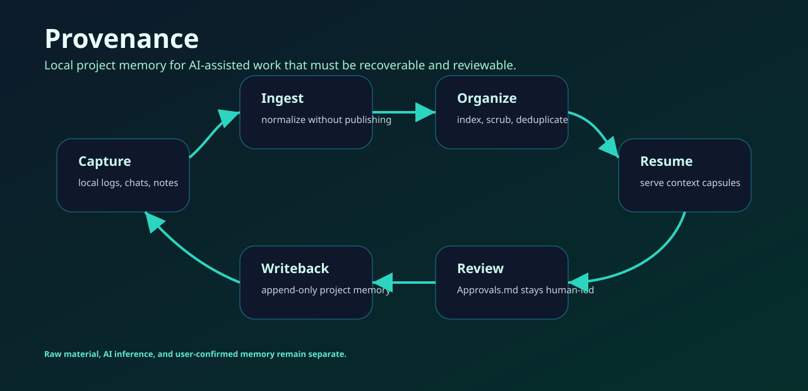

# Provenance

[](https://github.com/foxsplendid/Provenance/actions/workflows/ci.yml)
[](https://github.com/foxsplendid/Provenance/releases)
[](LICENSE)

Provenance is a local-first project memory engine for AI-assisted work. It captures local work history, normalizes it, keeps private material under user control, and serves bounded context back to future agents through command-line tools and MCP.



## The problem

AI work often fails at continuity. A later session cannot reliably tell which prior claim was accepted, what source supported it, what was only a draft, and what should be ignored. Provenance exists to make that continuity explicit without sending the user's private project memory to a hosted service by default.

Inside the Scriptorium suite, Provenance is the memory and trace layer. It can also be used independently as a local project-memory tool for long-running coding, research, writing, or operations work.

## What it does

| Capability | Description |
| --- | --- |
| Ingest | Reads selected local material such as agent logs, exported chats, notes, archives, and project records. |
| Scrub and organize | Separates raw input from derived memory, supports de-identification, and rebuilds local indexes. |
| Search | Provides local search over organized project memory. |
| Context capsule | Produces a bounded resume context for a future AI session. |
| MCP | Exposes read-only project context to compatible agent hosts. |
| Sync writeback | Supports reviewable session writeback through an approval surface. |
| Capture | Ships a small optional browser extension for exporting ChatGPT/Claude conversation history for local ingestion. |

## Quick start

```powershell
git clone https://github.com/foxsplendid/Provenance.git
cd Provenance
py -m venv .venv
.\.venv\Scripts\python.exe -m pip install -e .
.\.venv\Scripts\prov-status.exe --help
```

Create or refresh a local memory store from selected sources:

```powershell
.\.venv\Scripts\prov-ingest-agents.exe --help
.\.venv\Scripts\prov-ingest-takeout.exe --help
.\.venv\Scripts\prov-search.exe --help
```

Serve a project context capsule:

```powershell
.\.venv\Scripts\prov-context.exe --help
```

## Capture extension

Capture is the optional browser-export tool released from this repository. It is useful when the only available source of an AI session is the browser conversation page.

The extension is published as a release asset and can be installed independently through Scriptorium:

```powershell
scriptorium install capture --target D:\Tools\scriptorium-capture --run
```

The extension does not make Provenance a browser product. Its role is only to help the user export selected conversation history into local files.

## How Provenance fits the suite

```text
Scriptorium workspace
        │
        ├── source files and project config
        ├── Steward literature handoffs
        ├── Scriptorium Spec contracts
        └── Provenance memory store
                ├── raw captured material
                ├── organized searchable records
                ├── reviewable session writebacks
                └── context capsules for future agents
```

Provenance reads and writes public file contracts where suite interoperability matters. It should not be treated as a hidden database that other components call through private internals.

## Command families

| Family | Commands |
| --- | --- |
| Ingest | `prov-ingest`, `prov-ingest-agents`, `prov-ingest-takeout`, `prov-ingest-library`, `prov-ingest-vault`, `prov-ingest-notes` |
| Organize | `prov-organize`, `prov-prep`, `prov-diff`, `prov-scrub` |
| Search and context | `prov-search`, `prov-context`, `prov-status`, `prov-mcp` |
| Sync layer | `prov-sync-*` commands for enqueue, fill, pending review, approval, pull, unresolved items, and worker flow |
| Optional export | `prov-obsidian` |

## Privacy and safety model

Provenance is designed around three boundaries:

- Raw sources are not the same as project memory.
- AI-generated summaries are not automatically accepted claims.
- Reviewable writeback requires an explicit approval surface.

The project is local-first, but it is still a tool that reads sensitive local material when you point it at that material. Keep private sources out of public repositories, review exports before sharing them, and use synthetic fixtures for demonstrations.

## Documentation

- [Overview](docs/OVERVIEW.md)
- [Privacy](docs/PRIVACY.md)
- [Specification notes](docs/SPEC.md)
- [Sync-layer wiring](docs/sync-layer-wiring.md)
- [Capture README](01-capture/README.md)

## Development

```powershell
.\.venv\Scripts\python.exe -m unittest discover -s tests
```

## License

MIT. See [LICENSE](LICENSE).
